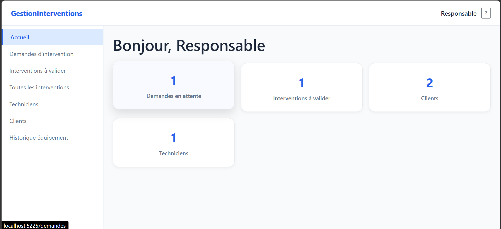
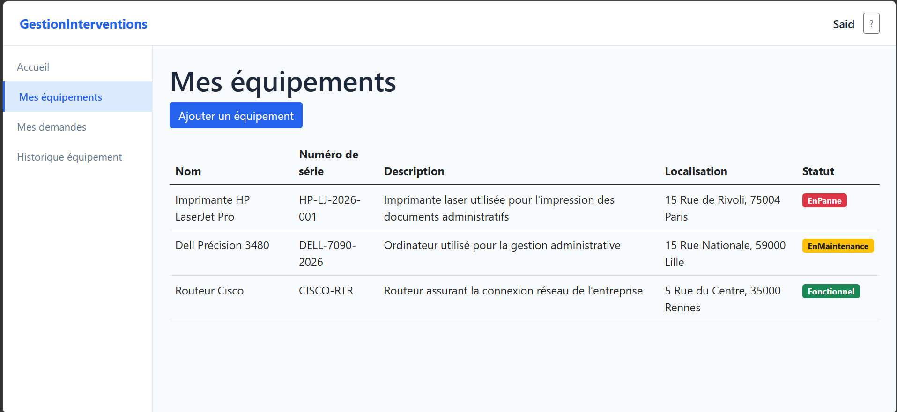
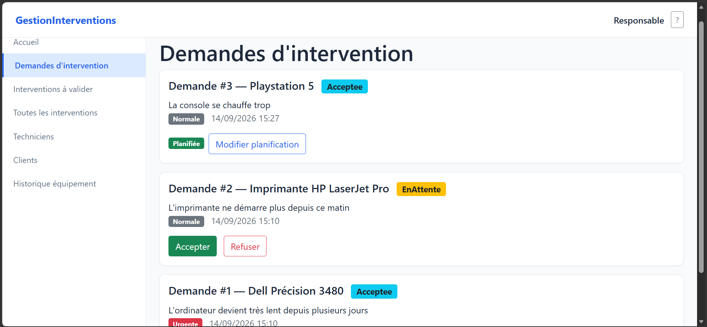
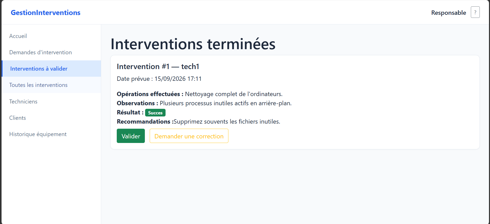

# GestionInterventions

🇫🇷 **Français** | 🇬🇧 [English](README_EN.md)

> Application web full-stack de gestion des interventions techniques, développée avec .NET et basée sur Clean Architecture, CQRS et les principes du Domain-Driven Design.

## 📋 Présentation

**GestionInterventions** est une application de gestion des interventions techniques permettant de suivre l'ensemble du cycle de maintenance d'une entreprise.

Le système permet aux clients de déclarer des problèmes sur leurs équipements, au responsable de traiter et planifier les demandes, et aux techniciens de réaliser les interventions et de renseigner leurs comptes rendus.

Le projet a été réalisé comme projet de formation afin de mettre en pratique une architecture logicielle structurée et des pratiques proches d'un environnement professionnel.

## 🌐 Démonstration en ligne

L'application est déployée sur Render.

- **Application Web :** [Accéder à Siyana DZ](https://siyana-web-demo.onrender.com/)

> **Note :** Cette version est hébergée sur l'offre gratuite de Render à des fins de démonstration. La base de données SQLite et les photos stockées localement peuvent être perdues après certains redémarrages ou redéploiements. La disponibilité du service peut également varier. Cette version n'est pas destinée à une utilisation en production avec des données importantes.

## 👥 Rôles et fonctionnalités

### Client

* Création de compte et authentification
* Gestion de ses équipements
* Déclaration de demandes d'intervention
* Suivi de l'état de ses demandes
* Consultation de l'historique de ses équipements
* Consultation des interventions et comptes rendus associés
* Mise à jour de ses informations personnelles
* Ajout et consultation de photos d'équipements, selon les fonctionnalités disponibles dans l'interface.

### Technicien

* Consultation des interventions qui lui sont assignées
* Démarrage d'une intervention
* Réalisation et clôture technique d'une intervention
* Saisie d'un compte rendu structuré
* Consultation des informations liées aux équipements et demandes

### Responsable

* Consultation des demandes en attente
* Acceptation ou refus des demandes
* Planification des interventions
* Affectation d'un technicien
* Modification d'une intervention planifiée
* Validation des interventions terminées
* Demande de correction d'une intervention
* Gestion des techniciens
* Consultation des clients et des interventions
* Consultation de l'historique complet des équipements
* Réception de notifications lors de nouvelles demandes grâce à SignalR.

Les principales règles métier sont centralisées dans le **Domain**, notamment les transitions d'état des demandes, équipements et interventions ainsi que les règles d'accès liées à la propriété des ressources.

## 🏗️ Architecture

Le projet suit une approche **Clean Architecture** avec séparation claire des responsabilités.

GestionInterventions.Domain
        ↓
GestionInterventions.Application
        ↓
GestionInterventions.Infrastructure
        ↓
GestionInterventions.Api
        ↓
GestionInterventions.Web

### Domain

Contient le cœur métier de l'application :

* Entités
* Énumérations
* Exceptions métier
* Value Objects
* Règles et invariants métier

Le Domain ne dépend pas d'Entity Framework Core, d'ASP.NET Core ou de l'interface utilisateur.

### Application

Contient les cas d'utilisation de l'application :

* Commands
* Queries
* Handlers MediatR
* DTOs
* Interfaces des repositories
* Validation

### Infrastructure

Contient les implémentations techniques :

* Entity Framework Core
* SQLite
* Repositories
* Unit of Work
* ASP.NET Core Identity
* Génération et validation des JWT
* Persistence

### API

Expose les fonctionnalités via une API REST :

* Gestion des clients, techniciens et équipements
* Demandes d'intervention et interventions
* Authentification et autorisation
* Gestion globale des erreurs
* Hub SignalR pour les notifications en temps réel

### Web

Interface utilisateur développée avec Blazor Web App en mode Interactive Server. Elle consomme l'API REST pour accéder aux fonctionnalités de l'application et utilise SignalR pour les notifications en temps réel.

## ⚙️ Principaux choix techniques

### CQRS + MediatR

Chaque cas d'utilisation est représenté par une **Command** ou une **Query**, avec un Handler dédié.

Command / Query
       ↓
    Handler
       ↓
Repository / Service
       ↓
     Domain

### Repository + Unit of Work

La couche Application ne dépend pas directement d'Entity Framework Core.

Les interfaces des repositories sont définies dans Application et leurs implémentations se trouvent dans Infrastructure.

### Authentification et autorisation

L'application utilise :

* ASP.NET Core Identity
* JWT Bearer Authentication
* Autorisation basée sur les rôles
* Vérification de propriété des ressources

Les informations sensibles sont stockées localement avec **User Secrets** et ne sont pas versionnées dans Git.

### Domain-Driven Design

Le modèle métier utilise notamment :

* Entités avec comportement
* Invariants métier
* Exceptions métier
* Value Object `CompteRendu`
* Méthodes métier explicites

Par exemple :

Equipement.SignalerPanne()
Intervention.Terminer(compteRendu)

plutôt que de modifier directement les états depuis les contrôleurs.

### Gestion globale des erreurs

Un middleware global transforme les exceptions métier en réponses HTTP appropriées afin de conserver des contrôleurs légers et cohérents.

### Notifications en temps réel avec SignalR

SignalR permet de transmettre des notifications de nouvelles demandes au responsable sans attendre un rechargement manuel de la page.

### Gestion des photos

L'application permet d'associer des photos aux équipements. Les fichiers sont téléversés et servis par l'API, tandis que l'interface Web utilise l'adresse configurée de l'API pour les afficher.

## 🛠️ Technologies

| Domaine             | Technologie                 |
| ------------------- | --------------------------- |
| Langage             | C#                          |
| Framework           | .NET 8 / ASP.NET Core       |
| API                 | ASP.NET Core Web API        |
| Frontend            | Blazor Web App              |
| ORM                 | Entity Framework Core       |
| Base de données     | SQLite                      |
| Architecture        | Clean Architecture          |
| Design              | Domain-Driven Design        |
| Pattern             | CQRS                        |
| Médiateur           | MediatR                     |
| Authentification    | ASP.NET Core Identity + JWT |
| UI                  | Bootstrap                   |
| Contrôle de version | Git / GitHub                |

## 📸 Captures d'écran

### Tableau de bord

### Gestion des équipements

### Gestion des demandes

### Gestion des interventions

> Les captures d'écran présentent les principales interfaces de l'application.

## 📁 Structure du projet

GestionInterventions/
├── src/
│   ├── GestionInterventions.Domain/
│   ├── GestionInterventions.Application/
│   ├── GestionInterventions.Infrastructure/
│   ├── GestionInterventions.Api/
│   └── GestionInterventions.Web/
├── screenshots/
├── GestionInterventions.sln
├── Dockerfile
├── Dockerfile.web
├── docker-compose.yml
├── .dockerignore
├── .gitignore
├── README.md
└── README_EN.md

## 🚀 Installation

### Prérequis

* .NET 8 SDK
* Git
* Docker Desktop si tu souhaites lancer l'application avec Docker.
* `dotnet-ef`

Installation de l'outil Entity Framework :

dotnet tool install --global dotnet-ef

### Cloner le projet

git clone https://github.com/madjidaouam7/GestionInterventions.git
cd GestionInterventions

### Restaurer et compiler

dotnet restore
dotnet build

### Configurer les secrets

Les secrets nécessaires à l'application doivent être configurés avec **User Secrets**.

Initialiser User Secrets :

dotnet user-secrets init --project src/GestionInterventions.Api

Configurer le mot de passe du compte Responsable :

dotnet user-secrets set "SeedAdmin:Password" "VOTRE_MOT_DE_PASSE" --project src/GestionInterventions.Api

Configurer la clé JWT :

dotnet user-secrets set "Jwt:Key" "VOTRE_CLE_JWT" --project src/GestionInterventions.Api

> Ne partagez jamais vos vraies valeurs de secrets dans le dépôt GitHub.

### Configurer l'URL de l'API

L'application Web doit connaître l'adresse de l'API. En local, la configuration par défaut du projet utilise :

http://localhost:5084/

Si l'API écoute sur une autre adresse ou un autre port, configure Api:BaseUrl dans les paramètres de l'application Web pour qu'il corresponde à l'adresse réelle de l'API.

### Créer / mettre à jour la base de données

dotnet ef database update --project src/GestionInterventions.Infrastructure --startup-project src/GestionInterventions.Api

### Lancer l'API

Dans un terminal :

dotnet run --project src/GestionInterventions.Api

### Lancer l'application Web

Dans un deuxième terminal :

dotnet run --project src/GestionInterventions.Web

## 🔐 Compte Responsable

Le compte Responsable est créé automatiquement lors de l'initialisation de l'application.

Pour des raisons de sécurité, le mot de passe n'est pas stocké dans le dépôt. Il doit être configuré localement avec **User Secrets**.

Les comptes Client peuvent être créés via l'inscription publique et les comptes Technicien peuvent être créés par le Responsable.

## 🐳 Lancement avec Docker

Le dépôt contient les fichiers Docker pour construire l'API et l'application Web, ainsi qu'une configuration Docker Compose.

Si Docker Desktop est installé et que la configuration locale nécessaire est en place, lance depuis la racine du dépôt :

docker compose up --build

Les services et leurs paramètres dépendent de la configuration de docker-compose.yml. Consulte ce fichier avant le lancement pour vérifier les ports, les variables d'environnement, les volumes et le réseau configurés.

Les secrets et les fichiers de données locaux ne doivent pas être ajoutés au dépôt Git.

## 🧪 Tests et intégration continue

Le projet comporte des projets de tests unitaires. Pour lancer les tests disponibles :

dotnet test

L'intégration continue avec GitHub Actions est une amélioration prévue afin d'automatiser la compilation et l'exécution des tests lors des push et des Pull Requests. Le statut du pipeline sera indiqué ici une fois sa configuration mise en place et vérifiée.

## 📌 État du projet

Projet de formation réalisé individuellement afin de mettre en pratique la conception et le développement d'une application web structurée avec ASP.NET Core.

Le projet met particulièrement l'accent sur :

* la séparation des responsabilités ;
* la conception orientée domaine ;
* CQRS et MediatR ;
* l'injection de dépendances ;
* l'accès aux données avec Entity Framework Core ;
* l'authentification et l'autorisation ;
* la conception d'une API REST ;
* la création d'une interface utilisateur avec Blazor ;
* Les notifications en temps réel avec SignalR ;
* La conteneurisation et le déploiement d'une démonstration en ligne.

## 📄 Licence

Projet réalisé à des fins de formation, de portfolio et de démonstration technique. Aucune licence open source spécifique n'est déclarée pour le moment.
